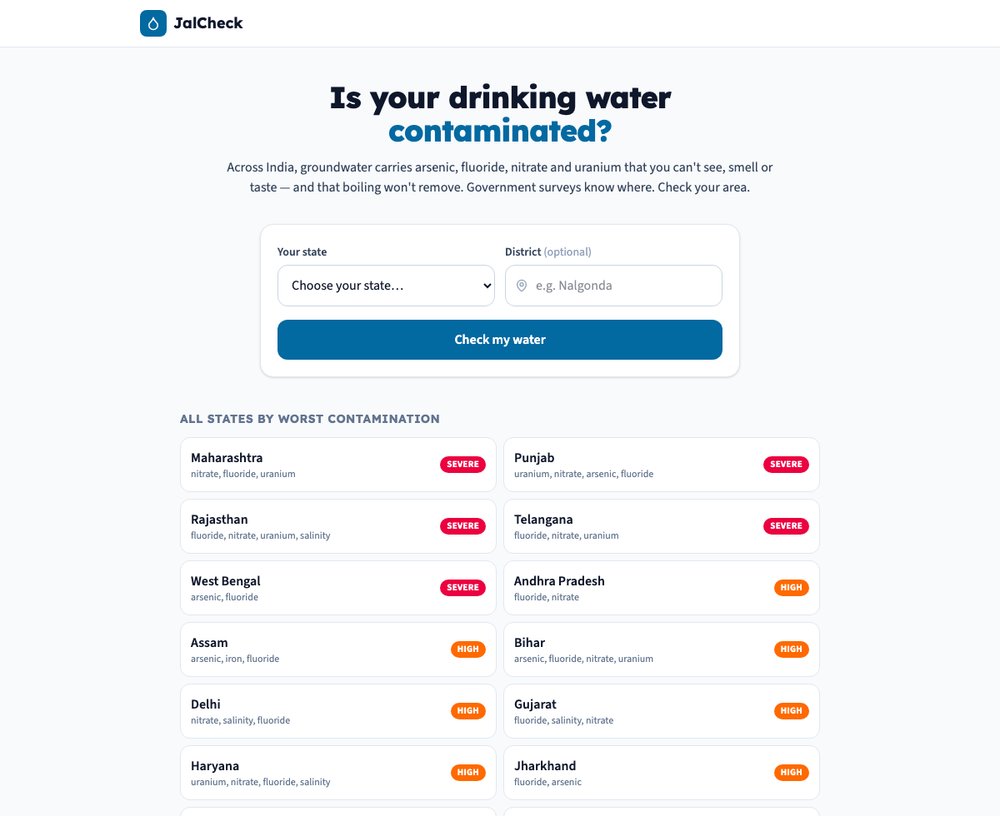
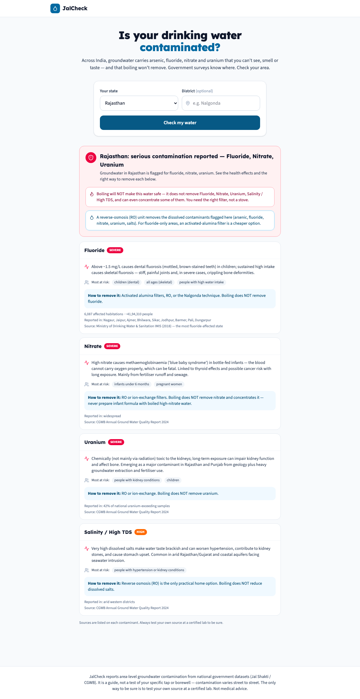
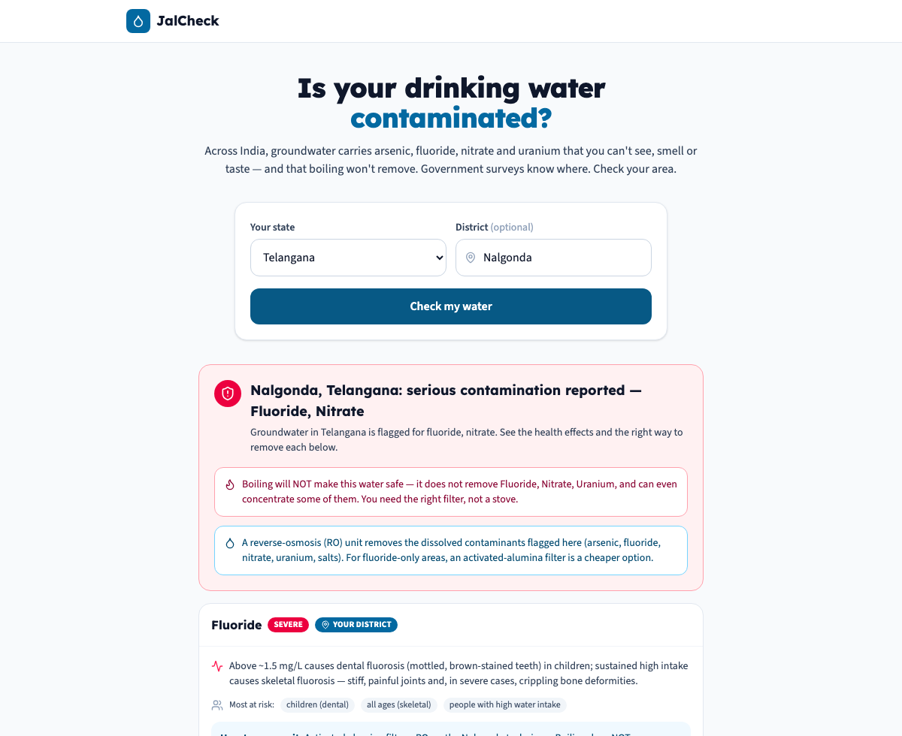

# JalCheck

[](https://github.com/shaurya703/jalcheck/actions/workflows/ci.yml)

**Find out what's contaminating your area's groundwater — arsenic, fluoride, nitrate, uranium — what it does to your body, and how to actually remove it.**

India runs the world's largest groundwater-quality monitoring effort. The Central Ground Water Board and the Jal Shakti ministry know, district by district, where the water carries **arsenic** (West Bengal, Assam, Bihar), **fluoride** (Rajasthan, Telangana, Karnataka), **nitrate** (56% of districts exceed the safe limit), and **uranium** (Rajasthan, Punjab). Tens of millions of people drink it.

But that knowledge sits in survey portals and PDF annexures no resident will ever open — and the contaminants that matter most are invisible: you can't see, smell or taste arsenic or fluoride, and **boiling doesn't remove them** (it can even concentrate them). JalCheck turns the surveys into a plain question: *"What's in my water, and what do I do about it?"*

| | | |
|---|---|---|
|  |  |  |

## How it works

### The data — real government contamination surveys

Two official sources, normalized into a structured dataset:

- **Affected-habitation counts** from the Ministry of Drinking Water & Sanitation's IMIS — the real per-state number of habitations and population affected by arsenic and fluoride (e.g. West Bengal: **10,846 arsenic-affected habitations, ~11.8 million people**; Rajasthan: **6,087 fluoride-affected habitations, ~4.2 million people**).
- **The CGWB Annual Ground Water Quality Report (2024)** for nitrate, uranium, iron and salinity — which states and districts exceed limits, and whether the source is geogenic or from fertiliser/industry.

Each of the 7 contaminants carries its **IS 10500 safe limit**, health effects, who's most vulnerable, and — the genuinely useful part — the correct removal method and whether boiling helps. Every state→contaminant record keeps its **source citation**, and a seed-time validator rejects any state that references an unknown contaminant.

### The risk engine

[`backend/app/engine.py`](backend/app/engine.py) turns a state (and optional district) into a ranked, plain-language report. The opinionated parts:

- **District awareness.** Name a district that appears in a contaminant's affected list and that risk is flagged *"in your district"* and floated to the top — local specificity beats a state average. *Nalgonda, Telangana → fluoride, flagged for your district.*
- **Boiling myth-busting.** If a serious contaminant resists boiling (arsenic, fluoride, nitrate, uranium all do), the report leads with an explicit warning — because "just boil it" is the dangerous, widespread default.
- **Actionable removal.** It names the right fix: RO for the dissolved geogenic set, activated alumina as the cheaper fluoride-only option, aeration for iron — not generic "use a filter."

**Example.** A user in *Rajasthan*:

```
overall: SEVERE — Fluoride, Nitrate, Uranium
⚠ Boiling will NOT make this water safe — it does not remove Fluoride, Nitrate, Uranium.
💧 A reverse-osmosis (RO) unit removes the dissolved contaminants flagged here.
  Fluoride  · severe · 6,087 affected habitations (~4.2M people)
            dental & skeletal fluorosis · most at risk: children, all ages
  Nitrate   · severe · blue-baby syndrome in infants · most at risk: infants under 6 months
  Uranium   · severe · kidney toxicity · 42% of national uranium-exceeding samples
```

### API

```
GET /api/states                 all states with worst-severity + contaminant list
GET /api/check?state=&district=  ranked risk report (district optional)
GET /api/contaminants           the reference table (limits, health, removal)
GET /api/stats                  dataset summary
GET /api/meta · /api/health
```

Consistent `{"error": {code, message}}` envelope; nothing about the query is stored.

## Running it

```bash
docker compose up --build
# frontend → http://localhost:3200   API → http://localhost:8200/docs
```

Local dev:

```bash
cd backend
python3 -m venv .venv && .venv/bin/pip install -r requirements-dev.txt
DATABASE_URL=sqlite:///dev.db .venv/bin/python -m scripts.seed
DATABASE_URL=sqlite:///dev.db .venv/bin/uvicorn app.main:app --reload --port 8200
cd frontend && npm install && npm run dev
```

### Tests

```bash
cd backend && .venv/bin/python -m pytest    # 21 tests
```

Tests assert the real IMIS figures load correctly, pin the engine's district-matching and severity ranking, and verify the boiling warning and RO recommendation fire for the right contaminants.

## Data sourcing & verification

- Every state→contaminant record cites its source (IMIS habitation data or CGWB 2024).
- The two sources measure different things and JalCheck keeps them distinct: IMIS counts *rural habitations not yet provided safe water* (so a 0 doesn't mean a state is geogenically clean), while CGWB measures *actual groundwater concentrations*. Severity reflects whichever source applies, labelled.
- The UI repeats everywhere: this is an **area-level guide, not a test of your specific tap** — test your own source at a certified lab.

## Limitations

- **Resolution is state, with notable districts** — not your street. Contamination varies within a district; only a lab test of your source is definitive.
- **It's a snapshot** of national reporting; a production build would sync CGWB's annual releases and add habitation-level WQMIS data.
- IMIS affected-habitation figures are from the last fully published cycle; concentrations shift with monsoon and extraction.

## What I'd build next

1. **Pincode / habitation resolution** by ingesting the granular JJM WQMIS test records.
2. **Map view** — choropleth of India by contaminant, drill down to district.
3. **"Test my water" routing** — nearest government-empanelled water-testing lab and what to ask for.
4. **Filter buying guide** — match the certified filter spec (e.g. NSF/IS 16240 for arsenic) to the contaminants found.
